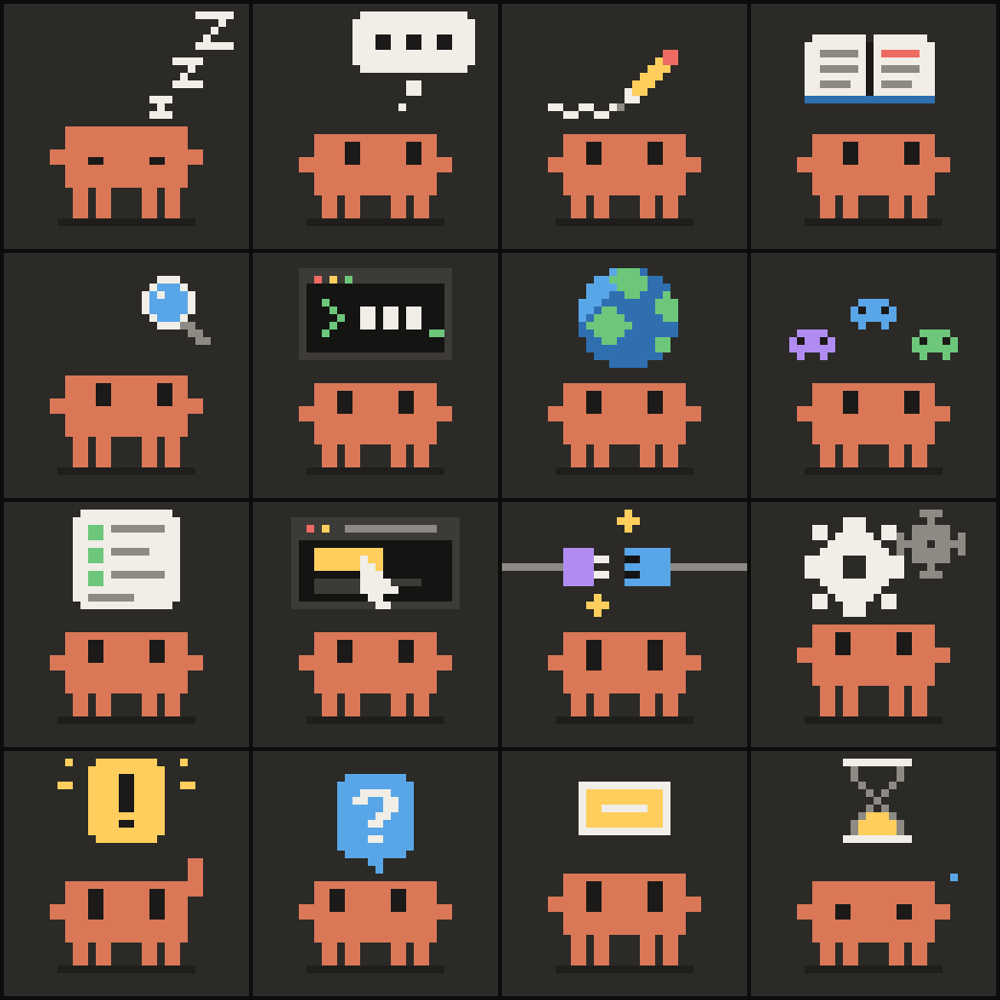

# Claude Code presence icons

Animated pixel-art icons for a Discord Rich Presence status: one scene per thing Claude Code
can be doing.

| File | Shown when |
| --- | --- |
| `idle.gif` | a session is open and nothing is happening |
| `thinking.gif` | the model is generating |
| `edit.gif` | editing files |
| `read.gif` | reading files |
| `search.gif` | searching the project |
| `shell.gif` | running commands |
| `web.gif` | searching or fetching the web |
| `agents.gif` | running subagents |
| `plan.gif` | planning |
| `browser.gif` | driving a browser |
| `mcp.gif` | calling external tools |
| `tool.gif` | any other tool |
| `approval.gif` | waiting for a permission click |
| `asking.gif` | waiting for an answer to a question |
| `compacting.gif` | compacting the context |
| `limit.gif` | waiting for the usage limit to reset |

Each is a 512×512 looping GIF drawn on a 32×32 grid.
